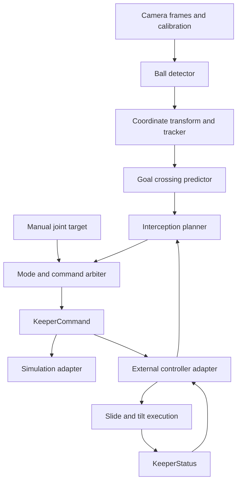

# Two-Axis Goalkeeper Architecture

Status: software framework with a local planning demo, generated adult keeper URDF, Gazebo launch, and ROS 2 shooter source. ROS 2 interception control and execution adapters are not implemented.

## 1. Objective and scope

Build a keeper that moves horizontally across the goal and tilts a panel left or right to block a predicted goal-plane crossing. Begin with manual targets and a two-axis simulation. Connect perception only after both axes can be commanded reliably.

The system must distinguish a ball crossing point from a joint target. A crossing point describes where and when a ball reaches the goal. A joint target describes the carriage position and panel angle chosen to cover that point.

## 2. Motion representation

| Element | Function | Planning requirement |
| --- | --- | --- |
| Slide joint | Moves the panel pivot left or right | Define lateral travel, speed, and acceleration limits |
| Tilt joint | Rotates the panel in the goal plane | Define the neutral angle, direction, and angular limits |
| Human-shaped footprint | Provides the blocking area | Use the union of head, torso, arm, glove, leg, and foot shapes; preserve gaps |

The tilt axis points along the shot direction, producing left/right tipping in the goal plane. Represent lateral motion with a prismatic joint and panel tilt with a revolute joint.

The shared model uses the regulation 7.32 m x 2.44 m goal opening and a generic 1.90 m-tall keeper with a 1.90 m arm span. The body rotates as one rigid silhouette about a 1.00 m pivot. Keeper proportions and motion limits are modelling assumptions; only the goal and penalty-mark measurements follow IFAB Law 1. See the [robot design](robot-design.md).

## 3. Data flow

Only the selected execution mode receives actuator commands. Simulation and hardware use the same high-level target contract, but have separate adapters and feedback topics. Manual and autonomous publishers must not compete for control.

## 4. Software responsibilities

| Module | Input | Output | Responsibility |
| --- | --- | --- | --- |
| Manual target node | Operator position and angle | KeeperCommand candidate | Allows motion testing without a camera |
| Ball detector | Images and camera calibration | Time-stamped ball observations | Detects the ball and supplies a position estimate |
| Transform and tracker | Observations and camera-to-goal transform | BallState | Produces position and velocity in goal_frame |
| Crossing predictor | BallState | InterceptTarget | Predicts goal-plane position, arrival time, and validity |
| Interception planner | InterceptTarget and axis status | KeeperCommand candidate | Selects a reachable blocking pose before arrival |
| Command arbiter | Manual or planned target | KeeperCommand | Enforces mode selection, limits, freshness, and arming |
| Simulation adapter | KeeperCommand | Joint trajectory | Drives the Gazebo model with defined axis limits |
| External controller adapter | KeeperCommand | Backend command and KeeperStatus | Converts units, tracks acknowledgments, and detects disconnects |

The topic names and message fields are defined in the [interface specification](interfaces.md).

## 5. Prediction and target selection

For a low, rolling-ball baseline, estimate velocity from recent time-stamped positions and extrapolate to the goal plane. Use a gravity-aware model when airborne shots enter the experiment. Do not mix camera pixels with metric goal coordinates.

In goal_frame the goal plane is x = 0. A ball approaching from x < 0 with positive vx has a linear crossing time t = -x / vx. Reject estimates with insufficient forward velocity, non-positive arrival time, stale observations, or excessive uncertainty.

The planner should:

1. Transform each occupied body-part footprint for candidate carriage positions and tilt angles.
2. Check whether that footprint intersects the ball's predicted cross-section.
3. Reject candidates outside travel, angle, or swept-clearance limits.
4. Estimate motion time from the current axis state and measured acceleration and speed limits.
5. Choose a candidate that can arrive before the ball, including measured communication and settling margins.
6. Report an unreachable target when no candidate meets these conditions.

A sampled search over candidate angles and slide positions is sufficient for the first planner. Translation-only interception is the first autonomous baseline; tilt then expands the blocking coverage. A single arctangent of the crossing coordinates is insufficient when the pivot can translate.

## 6. Execution strategy

Use Python ROS 2 nodes for target generation and system coordination. Keep the execution adapter separate so the planner depends only on joint positions, motion limits, deadlines, and feedback.

The planner outputs carriage position and panel angle. An execution adapter translates those targets into its backend's command format and reports state, completion, and faults. The existing serial codec is an optional, dry-run interface example; it does not prescribe a controller or actuator.

For simulation, use the Jazzy branch of gz_ros2_control and a joint trajectory controller for slide_joint and tilt_joint. Jazzy and Gazebo Harmonic are an officially supported combination. A position interface can model the axes initially, but realistic velocity and acceleration limits must be added before interpreting interception results. [Official integration guide](https://control.ros.org/jazzy/doc/gz_ros2_control/doc/index.html)

## 7. State, feedback, and stopping

Use separate states for DISARMED, HOMING, READY, MOVING, and FAULT. Homing is an explicit supervised operation. A restart or a lost connection must not trigger homing or motion automatically.

Establish the joint coordinate reference before accepting absolute position commands. On a command timeout, the execution backend stops using its validated stopping behavior. Recovery requires clearing the cause and explicitly rearming; restore the coordinate reference if position confidence was lost.

Distinguish commanded, estimated, and measured axis states in status messages and logs. The adapter must identify the feedback available from its backend.

## 8. Current implementation boundary

The goalkeeper_sim package contains a field, regulation goal, initial ball, and launch file. The goalkeeper_description package has a generated slide/tilt URDF matching the planner's body-part geometry. The penalty_shooter package has a ROS 2 shooter node using the installed geometry configuration. A local Python planner accepts a predicted goal-plane coordinate and returns a candidate pose and action path. The planner remains hardware-disabled and only previews a serial protocol line. Custom ROS messages, perception, the interception nodes, and a connected motion execution adapter remain unimplemented. Gazebo integration has not been runtime-verified here. The separate [ROS example configuration](../config/keeper.example.yaml) remains an unconsumed design placeholder.

Use the [implementation plan](implementation-plan.md) to build and validate these components in order.
