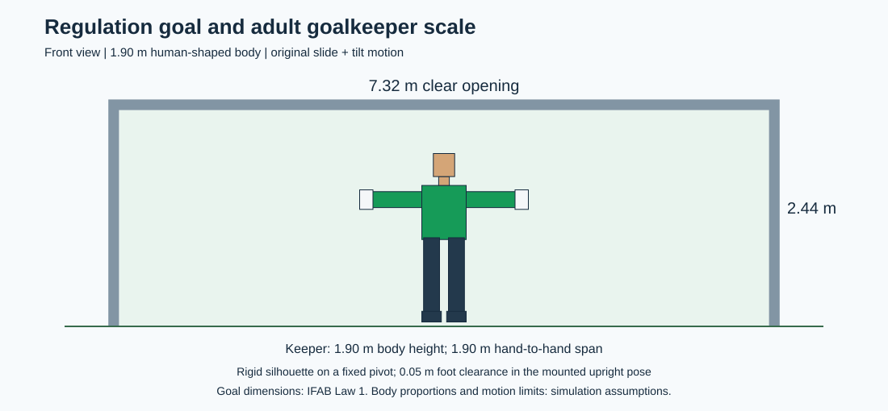

# Regulation-Size Goal and Adult Goalkeeper Model

Status: software planning and generated Gazebo geometry. The goal uses regulation 11-a-side dimensions. The keeper is an adult-sized rigid silhouette with the original sideways movement and left/right tilt.

## 1. Input and movement

The input is the ball-centre coordinate where the ball is predicted to cross the goal plane, plus its arrival time. In `goal_frame`, the goal plane is `x = 0`; the planner accepts `(0, y, z)` and returns the robot target `(slide_m, tilt_rad)`. A current ball position first needs a crossing prediction.

The two controlled axes are `slide_joint` along +Y and `tilt_joint` about +X. Positive tilt tips the upper body toward -Y. Head, torso, arms, gloves, legs, and feet form one rigid body. Individual limb movement, jumping, and athlete biomechanics are outside this model.

## 2. Planning geometry

| Item | Value | Basis |
| --- | ---: | --- |
| Goal clear opening | 7.32 m wide x 2.44 m high | IFAB Law 1: inside faces of posts and underside of crossbar |
| Penalty mark | 11.00 m from the back edge of the goal line | IFAB Law 1 |
| Goal member diameter | 0.12 m | Model choice within the Law 1 maximum |
| Keeper body height | 1.90 m, sole to crown | Generic adult goalkeeper assumption |
| Hand-to-hand span | 1.90 m | Model assumption with arms extended sideways |
| Torso width | 0.50 m | Model assumption; limbs have separate blocking shapes |
| Nominal body mass | 85 kg | Simulation inertia assumption, not a FIFA requirement |
| Slide joint travel | -3.20 m to +3.20 m | Model limit; full-body clearance further restricts poses near the posts |
| Tilt range | -45 deg to +45 deg | Original left/right tilt motion |
| Hip-like pivot height | 1.00 m above the ground | Fixed robot pivot shared by the planner and URDF |
| Upright foot clearance | 0.05 m | Mounted silhouette; allows continuous tilt without feet entering the floor |
| Upright crown height | 1.95 m above the ground | 1.90 m body plus 0.05 m mounting clearance |
| Ball radius | 0.11 m | Approximate size-5 ball geometry |
| Contact allowance | At least 0.05 m in the distance-based footprint check | Planning margin, not a measured save criterion |

The goal dimensions are official. FIFA does not prescribe one goalkeeper height or arm span. The [FIFA 2022 squad lists](https://fdp.fifa.org/assetspublic/ce44/pdf/SquadLists-English.pdf) list Manuel Neuer at 1.93 m and Thibaut Courtois at 1.99 m. The 1.90 m keeper here is a generic modelling choice, not a tournament average or a particular player's digital replica. See [IFAB Law 1](https://theifab.com/laws/latest/the-field-of-play/) for the official goal and penalty-mark measurements.



## 3. Shared geometry and coverage

[keeper.design.json](../config/keeper.design.json) is the source for the planner and generated robot geometry. Eleven body-part rectangles define the union of occupied blocking regions. Empty space around the head, between arms and torso, and between the legs is not filled by a single large rectangle.

Gazebo collision boxes use the same body parts and dimensions. The planner transforms them for slide and tilt, checks contact against the nearest occupied part, and checks the swept body against the floor, posts, and crossbar. Its swept bound is conservative and may reject a synchronized path that would actually fit. This is a 2D geometric contact test, not an impact or save model.

The goal plane is at world X = 10.00 m. Goal-member centres are at X = 9.94 m, so their back edge is at the goal plane. Post centres are at Y = +/-3.72 m and the crossbar centre is at Z = 2.50 m. With 0.06 m radii, the clear opening is exactly 7.32 m x 2.44 m. The penalty spot and initial ball are at world X = -1.00 m. The existing field is a cropped penalty-training scene.

After changing the geometry configuration, regenerate the assets, then rebuild the ROS packages:

```text
python3 tools/generate_geometry.py
```

The generator updates the URDF, goal geometry, penalty mark, initial ball position, and scale drawing.

## 4. Timing and reachability

| Timing item | Value | Status |
| --- | ---: | --- |
| Kick to goal-plane crossing | 0.55 s | User-supplied shot assumption |
| Recognition, prediction, and communication | 0.10 s | Budget example to measure later |
| Time remaining | 0.45 s | 0.55 - 0.10 s |
| Settling reserve | 0.02 s | Model margin |
| Available axis motion time | 0.43 s | 0.45 - 0.02 s |

Speed and acceleration assumptions remain 2.0 m/s and 12 m/s^2 for slide, and 4.0 rad/s and 20 rad/s^2 for tilt. They are not measured athlete or robot performance. Enlarging the goal does not make every shot reachable: a 3.20 m translation from centre alone requires about 1.767 s under these limits. The planner reports unreachable shots instead of inventing faster motion.

The offline sampled search has not been optimized or validated against the 0.10 s processing budget. Its execution time must be measured before real-time use.

For the built-in crossing point `(0, 1.30, 1.40) m`, the model selects approximately `slide = +0.22 m` and `tilt = -9 deg`. Movement begins at 0.10 s, finishes at about 0.371 s after the kick, and holds through the 0.55 s arrival. This is a calculated trajectory.

## 5. Run and inspect the action path

The demo has a built-in input and needs no example-data folder:

```text
python3 run_keeper.py demo
python3 run_keeper.py demo --path-csv action_path.csv
python3 run_keeper.py plan --y-m 1.30 --z-m 1.40 --arrival-time-s 0.55 --elapsed-s 0.10
```

Use `--input path/to/shot.json` for custom data containing `crossing_point_m`, `flight_time_from_kick_s`, `elapsed_since_kick_s`, and optional `robot_state`. Coordinates use metres, angles radians, and times seconds.

JSON output includes timing, reachability, the selected pose, action-path checkpoints, and a serial codec preview. CSV export includes the complete time-indexed path. No serial connection is opened and no robot is moved.

## 6. Validation and implementation boundary

```text
python3 tests/test_regulation_geometry.py -v
```

The checks cover the clear goal opening, penalty distance, matching URDF and planner geometry, empty-space handling, preserved slide/tilt axes, motion limits, deadlines, stationary poses, and CSV export.

The repository includes a ROS 2 shooter node, a robot-description package, and a Gazebo launch file. Executing a planned joint path, implementing custom ROS messages and perception, and verifying an end-to-end save remain integration work. A model and passing planner tests do not establish a physical save rate.
